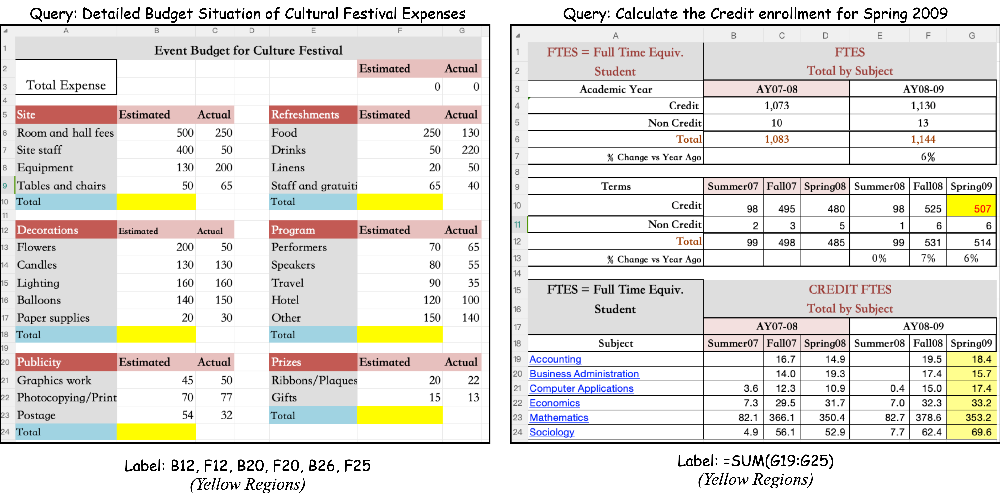
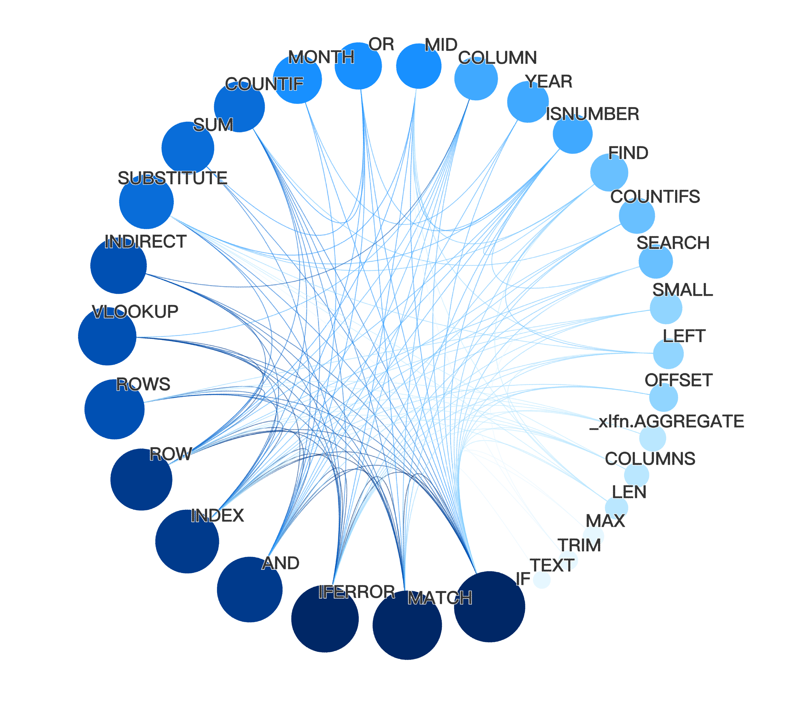
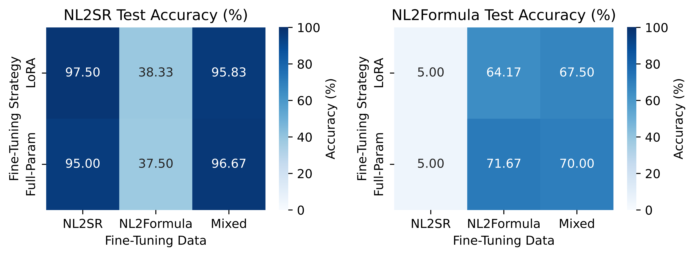

# Sheetpedia: A 300K-Spreadsheet Corpus for Spreadsheet Intelligence and LLM Fine-Tuning
[](https://tttiantt.github.io/Sheetpedia/)
[](https://openreview.net/forum?id=4vLYwlA3X5)
[](https://huggingface.co/datasets/tianzl66/Sheetpedia_xlsx)
[](https://github.com/TTtianTT/Sheetpedia)
[](https://creativecommons.org/licenses/by-sa/4.0/)


This repository contains the official code and resources for **Sheetpedia**, a large-scale corpus of over 290,000 diverse spreadsheets designed to advance AI research in spreadsheet understanding. This work was accepted to NeurIPS 2025 (Spotlight, DB track).

### Authors

[Zailong Tian](https://tttiantt.github.io/), [Zhuoheng Han](https://hzh030430.github.io/), [Houfeng Wang](https://scholar.google.com/citations?hl=en&user=YCX4y1gAAAAJ&view_op=list_works&sortby=pubdate), [Lizi Liao](https://liziliao.github.io/)

*Peking University & Singapore Management University*

## Introduction

Spreadsheets are ubiquitous tools for data analysis, but their semi-structured nature and complex formula logic pose significant challenges for AI systems. To address the scarcity of large-scale, formula-rich data, we introduce **Sheetpedia**, a new corpus of over **290,000 real-world spreadsheets** sourced from enterprise archives and public forums.

To demonstrate its utility, we define two novel tasks—**Natural Language to Semantic Range (NL2SR)** and **Natural Language to Formula (NL2Formula)**—and show that fine-tuning large language models on Sheetpedia achieves state-of-the-art results, reaching **97.5%** and **71.7%** accuracy, respectively. Sheetpedia fills a crucial data gap, paving the way for smarter and more intuitive spreadsheet intelligence tools.

<figure style="margin: 0; text-align: center; flex: 1; min-width: 300px; max-width: 450px;">
  
  <figcaption style="font-size: 0.9em; color: #7f8c8d; font-style: italic; margin-top: 10px;">
    <i>Fig. 1: Examples of the NL2SR (left) and NL2Formula (right) tasks.</i>
  </figcaption>
</figure>


## Key Contributions

  * **A Massive, Diverse Corpus**: We release the largest publicly available spreadsheet corpus, featuring ~290K unique worksheets rich in formulas and spanning numerous domains.
  * **Two Novel Benchmarks**: We introduce and release benchmarks for NL2SR and NL2Formula to evaluate model capabilities in spreadsheet interaction and code generation.
  * **State-of-the-Art Performance**: We demonstrate that models fine-tuned on Sheetpedia significantly outperform strong baselines, highlighting the value of domain-specific data for spreadsheet intelligence.

## The Sheetpedia Corpus

The corpus is compiled from three diverse sources and has undergone a rigorous preprocessing pipeline including format standardization, language filtering, and deduplication using MinHash LSH.

| Data Source  | Original Workbooks | Final Unique Worksheets |
| :----------- | :----------------- | :---------------------- |
| Enron        | ~16,000            | ~28,000                 |
| Fuse         | ~161,000           | ~105,000                |
| ExcelForum   | ~148,000           | ~157,000                |
| **Total** | **~325,000** | **~290,000** |

The corpus is characterized by a rich diversity of formula patterns, with `IF`, `SUM`, and `VLOOKUP` being the most prominent.

<div align="center" style="display: flex; justify-content: center; align-items: flex-start; gap: 30px; flex-wrap: wrap;">
  <figure style="margin: 0; text-align: center; flex: 1; min-width: 300px; max-width: 450px;">
    
    <figcaption style="font-size: 0.9em; color: #7f8c8d; font-style: italic; margin-top: 10px;">
      <i>Fig. 2: Co-occurrence network of top formulas.</i>
    </figcaption>
  </figure>
  <figure style="margin: 0; text-align: center; flex: 1; min-width: 300px; max-width: 450px;">
    
    <figcaption style="font-size: 0.9em; color: #7f8c8d; font-style: italic; margin-top: 10px;">
      <i>Fig. 3: Word cloud of common formula patterns.</i>
    </figcaption>
  </figure>
</div>


## Downstream Tasks & Results

We evaluate the corpus on two practical tasks:

1.  **Natural Language to Semantic Range (NL2SR)**: Mapping a user's natural language query to the correct cell range in a spreadsheet.
2.  **Natural Language to Formula (NL2Formula)**: Generating a valid Excel formula that fulfills a user's natural language description.

Using a rejection sampling framework to generate high-quality training data, our fine-tuned models achieve exceptional performance.

<figure style="text-align: center; margin: 20px auto;">
  
  <figcaption style="font-size: 0.9em; color: #7f8c8d; font-style: italic; margin-top: 10px;">
    <i>Fig. 4: Accuracy of different fine-tuning strategies on NL2SR and NL2Formula tasks using LLaMA-3.1-8B.</i>
  </figcaption>
</figure>


## Getting Started

### Accessing the Dataset

The full Sheetpedia corpus is available for download on the Hugging Face Hub:

**[https://huggingface.co/datasets/tianzl66/Sheetpedia_xlsx](https://huggingface.co/datasets/tianzl66/Sheetpedia_xlsx)**

### Code Usage: Replicating Our Results

This repository provides the complete pipeline for data generation, preprocessing, and evaluation.

**1. Clone the repository and install dependencies:**

```bash
# Clone the repository
git clone https://github.com/TTtianTT/Sheetpedia.git
cd Sheetpedia

# Install the required dependencies
pip install -r requirements.txt
```

**2. Data Generation:**

Generate the instruction-following dataset for our downstream tasks using the scripts in `src/data_generation/`. These scripts use LLMs to create synthetic data based on prompts and templates.

```bash
# Example for generating NL2Formula data
# Note: You may need to configure your API key in src/utils/api_util.py
python src/data_generation/nl2formula/new_nl2formula_generator_rs.py
```

**3. Data Preprocessing and Splitting:**

Process the generated raw data and split it into training, validation sets using the scripts in `src/data_preprocessing/`.

```bash
# Example for generating NL2Formula train/val set
# Automated Train/Validation Set Splitting and Formatting
python src/data_preprocessing/nl2formula/nl2formula_preprocessor.py --input_path ... --output_path ./data/nl2formula_0shot.jsonl
# Take this command for example, then you will get 1./data/nl2formula_0shot.jsonl 2./data/nl2formula_0shot_train.jsonl 3./data/nl2formula_0shot_val.jsonl
```

**4. Fine-Tuning (External):**

This repository focuses on data generation and evaluation. You can use the generated datasets from the previous step to fine-tune your own Large Language Model.

For example, use frameworks like Hugging Face TRL to fine-tune LLaMA-3.1-8B on the `train.jsonl` and `validation.jsonl` files located in the `./data/` directory.

**5. Inference:**

Get the prediction of your fine-tuned model or API.

**6. Evaluation:**

After fine-tuning your model, use our evaluation scripts in `src/data_evaluation/` to calculate performance metrics.

```bash
# Example for evaluating NL2Formula results
python src/data_evaluation/nl2formula/nl2formula_result_evaluator.py \
  --prediction_file ./data/nl2formula_results/gpt4o_predictions.jsonl
```
